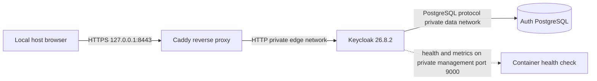

# Архитектура platform foundation

Compose разделяет `edge` и `data` как internal networks. Caddy и Keycloak соединены только через `edge`; Keycloak и PostgreSQL — только через `data`. PostgreSQL, Keycloak HTTP и management ports не имеют `ports` mappings. Host binding прокси жёстко ограничен `127.0.0.1`. Caddy предъявляет локальный сертификат, а Keycloak получает только proxy headers от единственного upstream proxy. Proxy отказывает по `/admin` и `/admin/*`. Admin endpoints управления не имеют публичной публикации.

Keycloak построен в два этапа: `kc.sh build` включает PostgreSQL, health и metrics, runtime запускается как непривилегированный пользователь upstream image командой `start --optimized`. Образ закреплён release 26.8.2 и digest `sha256:3879c623248408de29a5303178b5816c77e8dfef3890c361f8c0bbeaa979ba3b`. Обновления требуют сверки digest с registry и security advisories. Ветка AUTH-002 не импортирует realm и не создаёт OAuth clients.

Секреты DB/bootstrap admin и TLS key хранятся в локальных файловых mounts, исключённых из Git и Docker build context. Entrypoint читает секретные файлы и передаёт необходимые параметры Keycloak процессу; PostgreSQL использует штатный `POSTGRES_PASSWORD_FILE`. CI создаёт одноразовые значения в job и завершает Compose с удалением volume. Этот локальный шаблон не заменяет внешнее хранилище секретов и контролируемую ротацию.
